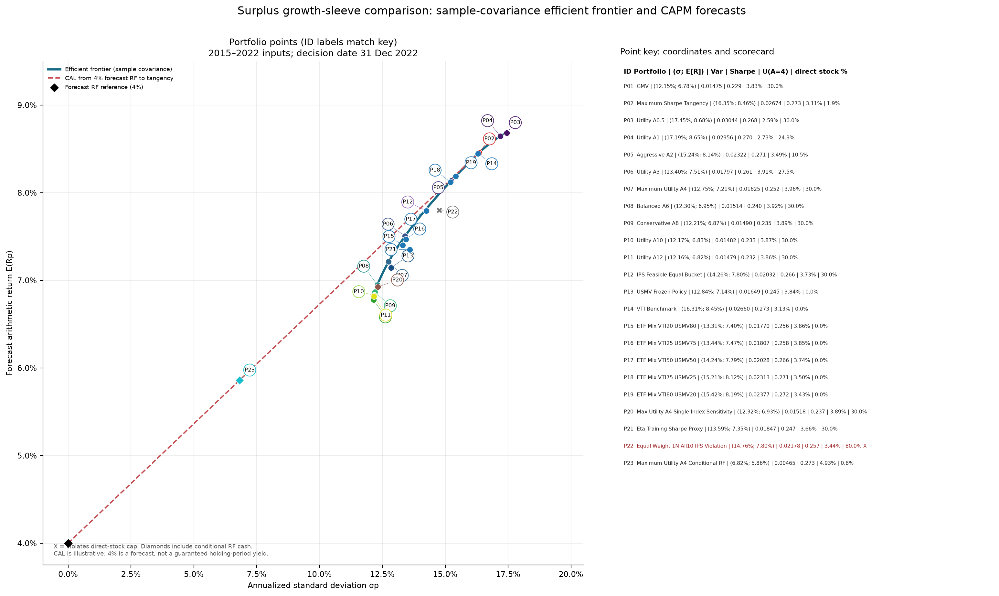

# Phân bổ vốn dư sau khi khớp nghĩa vụ: danh mục và đường biên hiệu quả

**Tài liệu tư vấn, không phải sửa đổi IPS.** Ngày quyết định được giữ là 31/12/2022; trọng số được tính từ 96 tháng dữ liệu 01/2015–12/2022. Dữ liệu 2023–2025 không tham gia lựa chọn. Chính sách đóng băng không bị thay đổi.

> **Đính chính quan trọng:** đề không đặt sẵn giới hạn tối đa 10% mỗi cổ phiếu hay 30% cổ phiếu trực tiếp; người dùng cũng chưa phê duyệt các mức này. Bảng và biểu đồ tĩnh ở dưới được tạo từ **một kịch bản phân tích trước đây có áp giới hạn 10%/30% do analyst tự thêm**, nên không phải bộ kết quả cơ sở hay giới hạn IPS đã được chốt. Xem giải thích và công cụ mới mặc định không áp thêm trần tại [MODEL_CHOICES_AND_CONSTRAINT_CORRECTION_VI.md](MODEL_CHOICES_AND_CONSTRAINT_CORRECTION_VI.md). Dùng `analysis/interactive_surplus_portfolio_lab.py` để so sánh kịch bản không trần với các trần tùy chọn.

## 1. Làm rõ khoản chi và định nghĩa vốn dư

Trong bộ đề và dữ liệu gốc của dự án, nghĩa vụ là **USD 2.4m vào 31/12/2024** và **USD 3.6m vào 31/12/2027**. Người dùng đã xác nhận khoản thứ hai vẫn là năm 2027; các tính toán dùng 2024/2027.

Theo giả định trái phiếu của case, quỹ dành USD 2,214,672 mua Beta để trả khoản 2024 và USD 3,429,808.70 mua Delta để trả khoản 2027. Đây là **cash-flow dedication/hold-to-maturity**: ghép các khoản tiền hợp đồng với ngày cần chi. Gọi là immunization chỉ đúng nếu dùng theo nghĩa rộng; kỹ thuật miễn nhiễm duration truyền thống cân bằng độ nhạy giá trị tài sản/nợ với lãi suất, khác với ghép dòng tiền cụ thể.

Vốn dư đầu tư ban đầu được tính:

`USD 12,000,000 − 2,214,672 − 3,429,808.70 − 9,168.59 phí = USD 6,346,350.71`.

Đây là phần có thể chịu rủi ro thị trường để theo đuổi mục tiêu sức mua 2030, sau khi nghĩa vụ đã được cấp vốn. Coupon Delta dư khoảng USD 486,956.52 đến 2030 là dòng tiền tương lai; theo giả định cơ sở 0% tái đầu tư, không cộng nó vào vốn dư ban đầu. Không dùng phần trái phiếu đã earmark làm tài sản rủi ro.

## 2. Mục tiêu tối ưu hóa và mô hình

### Tầng thứ nhất: nghĩa vụ

Giữ coverage của hai khoản đến hạn đầy đủ theo giả định trái phiếu không vỡ nợ và quỹ nắm đến đáo hạn. Đây là ràng buộc cứng trước khi tối ưu phần tăng trưởng. Trái phiếu Beta/Delta không nằm trong covariance của growth sleeve và không bị bán chỉ để tăng lợi suất cổ phiếu.

### Tầng thứ hai: growth sleeve rủi ro

Đề cấm vay, bán khống và phái sinh, vì vậy bộ so sánh long-only. Trong lần phân tích cũ, analyst còn tự đặt tối đa 10% mỗi cổ phiếu và tổng 30% cổ phiếu trực tiếp; người dùng chưa xác nhận các mức đó. Các bảng tĩnh dưới đây là sensitivity có các giới hạn ấy, không phải ràng buộc IPS. A=4 cũng chỉ là giả định working để minh họa utility, chưa được chốt. Mục tiêu utility là một tiêu chí có thể cân nhắc, không phải yêu cầu bắt buộc hay quyết định cuối cùng:

`max_w U(w) = w′μ − 0.5 × A × w′Σw`, `A=4`, `Σ` là covariance năm.

GMV và maximum Sharpe được tính riêng để đối chiếu. Chúng trả lời các câu hỏi khác nhau:

- **GMV** chọn biến động ước tính thấp nhất, không quan tâm lợi suất nếu không làm tăng biến động.
- **Tangency / max Sharpe** tối đa hóa `(E(Rp) − Rf) / σp`; tập trung vào phần bù lợi suất trên một đơn vị rủi ro.
- **Maximum utility** cân bằng lợi suất và phương sai theo A. A càng cao thì nghiệm thường dịch về danh mục ít rủi ro; A là giả định của quỹ, không phải con số được suy ra từ một Sharpe lịch sử.

### Lợi suất kỳ vọng và covariance

Trong bộ tính cũ, lợi suất kỳ vọng dùng **CAPM, alpha dự phóng bằng 0**:

`E(Ri) = Rf_fwd + βi × ERP = 4.0% + βi × 4.5%`.

Beta được ước lượng từ dữ liệu đến 12/2022. FF3 trong dự án dùng để giải thích/phân tích lợi suất vượt trội lịch sử, không phải để thay CAPM bằng dự báo lợi suất. Một dự báo FF3 cần quy định trước phần bù kỳ vọng của SMB và HML: `Rf + βM×ERP_M + βS×E(SMB) + βH×E(HML) + alpha`; nhóm chưa chọn các phần bù đó nên không tự tạo thêm giả định.

Ma trận covariance mẫu dùng cùng 96 quan sát lợi suất tháng 2015–2022 và được nhân 12 để biểu diễn năm. Sensitivity chạy lại utility với covariance single-index. Lợi suất, độ lệch chuẩn và phương sai trong bảng là **đầu vào mô hình**, không phải dự báo chắc chắn.

Sharpe trong bảng là **forecast Sharpe**, `(μp−4%)/σp`, dùng RF dự phóng 4% nhất quán với CAPM; nó khác Sharpe lịch sử, vốn dùng chuỗi FF3 RF thực tế theo từng tháng. Phương sai là phương sai năm (ví dụ 0.01625 tương đương khoảng 1.625%²; độ lệch chuẩn là căn bậc hai, khoảng 12.75%).

### Efficient frontier, CAL và vai trò của A

Đường biên được dựng bằng bài toán:

`max_w w′μ` với `w′Σw ≤ σ_target²`, `Σ wi=1`, `wi≥0`; các trần tỷ trọng dùng trong biểu đồ tĩnh là trần sensitivity do analyst đặt, không phải IPS.

Đường CAL lý thuyết từ tài sản phi rủi ro có lợi suất dự phóng 4% đến danh mục tangency có độ dốc Sharpe tối đa. Không cho vay/đòn bẩy, nên chỉ xét đoạn từ 0% đến 100% danh mục tangency. Nếu cho phép giữ tài sản phi rủi ro, tỷ trọng tangency tối ưu theo A là:

`y* = (E(RT)−Rf) / (A × σT²)`.

Với A=4, số liệu giới hạn cũ cho `y ≈ 41.69%` tangency và `58.31%` tài sản phi rủi ro; lợi suất kỳ vọng danh mục khoảng 5.86%, biến động 6.82%, U khoảng 4.93%. Đây là **kịch bản có điều kiện**, không phải khuyến nghị: RF 4% chỉ là đầu vào dự phóng, không phải cam kết quỹ khóa được 4% cho toàn kỳ. Có thể giữ tiền mặt theo đề; việc có dùng cash/T-bills trong phần dư là lựa chọn chính sách cần thảo luận. Giả định lãi tái đầu tư coupon cơ sở vẫn là 0%.

## 3. So sánh các danh mục

Các danh mục sau đều tính trên vốn dư, trừ hai hàng được ghi rõ là đối chứng/điều kiện. Utility trong cột cuối tính **cùng A=4 cho tất cả** để so sánh công bằng; Conservative A8, Balanced A6 và Aggressive A2 là cách tạo trọng số tương ứng với mức ngại rủi ro khác nhau.

| Danh mục | E(Rp) | σp | Variance năm | Forecast Sharpe (Rf=4%) | Utility U, A=4 | Cổ phiếu trực tiếp | Tóm tắt trọng số |
|---|---:|---:|---:|---:|---:|---:|---|
| GMV | 6.778% | 12.146% | 0.014753 | 0.2287 | 3.827% | 30.00% | JNJ 10%, PG 10%, NEE 10%, USMV 70% |
| Tangency / Maximum Sharpe | 8.459% | 16.351% | 0.026736 | 0.2727 | 3.112% | 1.95% | VTI 98.05%; AAPL 0.78%, MSFT 0.51%, JPM 0.65% |
| Maximum Utility A=4, risky universe | 7.212% | 12.748% | 0.016250 | 0.2519 | **3.962%** | 30.00% | USMV 51.90%, VTI 18.10%; cổ phiếu: PG 10%, JNJ 6.67%, NEE 6.00%, JPM 2.88%, XOM 2.24%, MSFT 2.21% |
| Conservative A=8 | 6.866% | 12.206% | 0.014898 | 0.2348 | 3.886% | 30.00% | USMV 70%; JNJ 9.76%, PG 10%, NEE 7.31%; cổ phiếu khác nhỏ |
| Balanced A=6 | 6.947% | 12.302% | 0.015135 | 0.2396 | 3.920% | 30.00% | USMV 70%; JNJ 7.74%, PG 10%, NEE 6.17%; cổ phiếu khác nhỏ |
| Aggressive A=2 | 8.135% | 15.237% | 0.023217 | 0.2714 | 3.492% | 10.51% | VTI 80.81%, USMV 8.68%; cổ phiếu trực tiếp còn lại 10.51% |
| Equal 1/N, 10 tài sản | 7.799% | 14.757% | 0.021778 | 0.2574 | 3.444% | **80.00%** | 10% mỗi cổ phiếu/ETF; vượt giới hạn 30% của kịch bản analyst cũ, không phải giới hạn đề bắt buộc |
| Equal bucket khả thi | 7.796% | 14.256% | 0.020322 | 0.2663 | 3.732% | 30.00% | 3.75% mỗi 8 cổ phiếu; 35% mỗi ETF; benchmark khả thi, không phải 1/N |
| Chính sách đóng băng USMV | 7.143% | 12.841% | 0.016488 | 0.2447 | 3.845% | 0.00% | 100% USMV trong growth sleeve |
| Utility A=4, single-index sensitivity | 6.926% | 12.320% | 0.015178 | 0.2375 | 3.890% | 30.00% | USMV 58.66%, VTI 11.34%; JNJ, PG, NEE mỗi mã 10% |
| Utility A=4 trên CAL | 5.859% | 6.817% | 0.004647 | 0.2727 | 4.929% | 0.81% | Tangency 41.69% + cash giả định 58.31%; chỉ dùng nếu 4% RF đầu tư được và được IPS cho phép |

Trọng số đầy đủ cho từng mã trong các phương án giới hạn cũ được ghi trong `outputs/tables/surplus_portfolio_combinations.csv`; số USD từng tài sản và phần tiền mặt trong `outputs/tables/surplus_portfolio_full_fund_bridge.csv`. Cột `ips_feasible` của các tệp này thực chất đánh dấu mức tuân thủ giới hạn analyst 10%/30% đã thêm ở thời điểm đó; không có nghĩa 1/N vi phạm đề hay policy người dùng đã chốt.

### Cách đọc kết quả để ra quyết định

Trong **kịch bản giới hạn analyst cũ**, maximum utility A=4 có điểm cao nhất trong số danh mục rủi ro đã liệt kê. Đây không phải kết luận cuối cùng vì người dùng chưa chọn A hay giới hạn tỷ trọng, và mean-variance tối ưu khác đi khi bỏ các giới hạn hoặc đổi covariance. USMV có utility 3.845%, thấp hơn optimizer covariance mẫu khoảng 0.117 điểm phần trăm/năm trong đúng kịch bản giới hạn đó; khoảng cách không bền trước sai số tham số, chi phí, survivorship bias và đổi cửa sổ.

Tangency có Sharpe cao nhất trong các tài sản rủi ro, nhưng A=4 không chọn 100% tangency: utility của nó chỉ 3.112%, thấp hơn 3.962% của Maximum Utility A4. Đây là lý do không nên lấy “Sharpe cao nhất” làm tiêu chí duy nhất cho quỹ có nghĩa vụ tương lai và mức ngại rủi ro.

Kết quả này tối ưu mean–variance cho growth sleeve; nó **chưa chứng minh** xác suất đạt mục tiêu sức mua 8m vào 2030 cao nhất. Mô phỏng goal hiện có chỉ bao phủ USMV và VTI. Muốn tuyên bố “tối ưu toàn quỹ”, cần chạy cùng một mô hình dòng tiền/Monte Carlo, shortfall severity và stress test cho tất cả các phương án, giữ hai nghĩa vụ ngoài phần growth risky assets.

## Đường biên và CAL

Biểu đồ tĩnh này còn phản ánh giới hạn 10%/30% đã được tự thêm trong lần phân tích trước: dấu `X` chỉ báo equal-weight vượt trần analyst ấy, **không phải vi phạm đề/IPS**. Đường xanh là efficient frontier theo covariance mẫu; đường đỏ đứt là CAL minh họa từ RF dự phóng 4% đến tangency.

## Quy trình tái lập và kiểm tra

1. Kiểm tra `analysis/config.json`: cutoff 2022-12-31; train đến 2022-12; CAPM RF 4%; ERP 4.5%; A=4; hai giới hạn 10%/30% là giả định analyst trong cấu hình cũ, chưa được người dùng xác nhận.
2. Mở `outputs/tables/funding_summary.json`: kiểm tra vốn Beta/Delta, phí và vốn surplus 6,346,350.71 USD. So với `outputs/tables/funding_cashflows.csv` để xác nhận ngày chi gốc 2024/2027.
3. Bảng CSV tĩnh cũ kiểm tra tổng trọng số/variance/σ/Sharpe/utility của kịch bản có trần cũ. Hàng 1/N có 80% cổ phiếu trực tiếp và cờ false theo giới hạn analyst 30%; không gọi đây là vi phạm IPS.
4. Mở `outputs/tables/surplus_efficient_frontier.csv`: có 70 điểm mục tiêu rủi ro đã giải bằng điều kiện phương sai tối đa.
5. Mở `outputs/tables/surplus_portfolio_full_fund_bridge.csv`: trái phiếu và phí giống nhau giữa các phương án; phần USD trong growth sleeve cộng lại bằng 6,346,350.71 USD.
6. Chạy công cụ tương tác mới từ dữ liệu cục bộ: `.venv\Scripts\python.exe analysis\interactive_surplus_portfolio_lab.py`; kiểm tra tự động: thêm `--self-test`. Script mặc định không đặt thêm trần tỷ trọng, cho phép bật các mức đó như sensitivity và tách train/evaluation.

**Chưa nên chọn một nghiệm làm policy chỉ từ bảng optimizer.** Người dùng đã xác nhận nghĩa vụ thứ hai vẫn là năm 2027 theo đề. Các điểm còn cần nhóm/trustees chọn là (i) có dùng cash/T-bills trong phần dư hay đầu tư toàn bộ growth sleeve, và (ii) có đề xuất giới hạn tập trung nào để kiểm soát optimizer dồn vào một tài sản hay để trống trong baseline rồi so sánh các sensitivity.

## Bản mở rộng so sánh: 23 danh mục và hai biểu đồ

Để việc so sánh không phụ thuộc vào một vài phương án minh họa, script hiện tạo **23 combination**, mỗi phương án có ID P01–P23. Bảng CSV là bảng số liệu chuẩn; điểm trên đồ thị chỉ ghi ID để không chồng tên dài lên nhau. Khung chú giải bên phải đồ thị ghép từng ID với tên, tọa độ `(σ; E[R])`, phương sai, Sharpe dự phóng, Utility A=4, tỷ trọng cổ phiếu trực tiếp và dấu vi phạm IPS. Dùng ID trong hình để tìm đúng hàng trong CSV.

| Nhóm phương án | ID | Câu hỏi so sánh |
|---|---|---|
| GMV, Tangency và nghiệm Utility A=0.5, 1, 2, 3, 4, 6, 8, 10, 12 | P01–P11 | Khẩu vị rủi ro A làm thay đổi danh mục tối ưu ra sao? |
| Equal-bucket khả thi; frozen USMV; VTI; ETF mixes VTI/USMV 20/80, 25/75, 50/50, 75/25, 80/20 | P12–P19 | So sánh chính sách hiện tại với benchmark và các mức pha trộn ETF đơn giản |
| Utility A4 theo covariance single-index; Eta training-Sharpe proxy | P20–P21 | Kết quả phụ thuộc thế nào vào ước lượng rủi ro và cách diễn giải đề xuất Eta? |
| Literal 1/N trên cả 10 risky assets; Utility A4 trên CAL có tiền mặt | P22–P23 | Cho thấy một đối chứng vi phạm giới hạn và một phương án có điều kiện về tài sản phi rủi ro |

### Cách đọc biểu đồ điểm (efficient frontier và CAL)

1. Tìm Pxx ở vùng điểm trên biểu đồ; trục ngang là độ lệch chuẩn năm `σp`, trục dọc là lợi suất số học dự phóng `E(Rp)`.
2. Tra cùng Pxx ở bảng chú giải bên phải để đọc tên và các số: `(σ; E[R])`, variance năm, Sharpe, `U(A=4)` và tỷ lệ cổ phiếu trực tiếp. Dấu `X` màu đỏ là P22, vi phạm trần cổ phiếu trực tiếp 30%; hình thoi là danh mục có thêm tiền mặt giả định.
3. Mở `outputs/tables/surplus_portfolio_combinations.csv` để xem toàn bộ tỷ trọng từng ETF/cổ phiếu, CAGR/volatility/Sharpe/drawdown huấn luyện, kiểm tra tính khả thi IPS và covariance basis. Tọa độ/score trong hình được làm tròn để đọc; CSV giữ độ chính xác đầy đủ.
4. Đường frontier là các nghiệm theo ràng buộc rủi ro với sample covariance. CAL là đường minh họa từ RF dự phóng 4% tới tangency. Vì 4% không phải lãi suất được bảo đảm khóa cho toàn kỳ và tiền mặt chưa được xác nhận trong IPS, P23 không được hiểu là khuyến nghị mặc định.

### Cách đọc radar

Radar chỉ vẽ 8 danh mục đại diện: P01 GMV, P02 Tangency, P07 Utility A4, P09 Conservative A8, P05 Aggressive A2, P13 frozen USMV, P14 VTI và P12 equal-bucket khả thi. Các trục là lợi suất dự phóng, certainty equivalent (CE) ở A=4, Sharpe dự phóng, độ biến động thấp hơn và drawdown huấn luyện nông hơn. Mỗi trục được chuẩn hóa min–max thành 0–100 trên toàn bộ các danh mục fully invested và IPS-compliant trong tập so sánh; điểm cao hơn tốt hơn **theo riêng tiêu chí của trục đó**. Bảng bên phải cho điểm cụ thể từng trục và ID.

Không cộng năm điểm thành tổng, không chọn polygon có diện tích lớn nhất: các trục có tương quan/chồng lặp, và min–max thay đổi nếu đổi tập đối chiếu. Radar phù hợp để trình bày đánh đổi, không thay thế hàm mục tiêu. Theo chính sách hiện tại, quyết định phải dựa trên utility A=4 và giới hạn IPS, còn stress test nghĩa vụ phải kiểm tra ở cấp toàn quỹ.

### File đầu ra cập nhật và tái lập

- Biểu đồ điểm: `outputs/figures/surplus_efficient_frontier_CAL.png`.
- Radar và bảng điểm chính xác: `outputs/figures/surplus_portfolio_radar.png` và `outputs/tables/surplus_portfolio_radar_scores.csv`.
- 23 danh mục, weights, forecast metrics và lịch sử huấn luyện: `outputs/tables/surplus_portfolio_combinations.csv`.
- Bảng tra ID của biểu đồ điểm: `outputs/tables/surplus_portfolio_point_legend.csv`.
- Tác động USD toàn quỹ: `outputs/tables/surplus_portfolio_full_fund_bridge.csv`.
- Receipt số lượng danh mục, quy ước, hash policy và danh sách tệp: `outputs/tables/surplus_portfolio_receipt.json`.

Chạy lại: `.venv\Scripts\python.exe analysis\surplus_portfolio_combinations.py`. Script kiểm tra 23 danh mục đủ 100% trọng số, các phương án trừ đối chứng P22 tuân thủ trần, các kiểm tra đầu vào CAPM/covariance, funding bridge và hash `policy/frozen_policy.json` không đổi.
