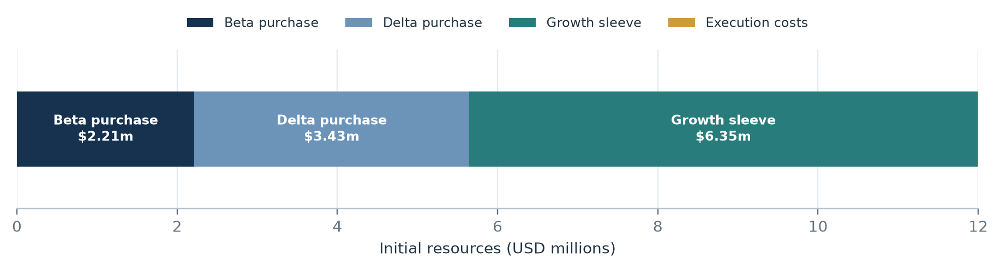
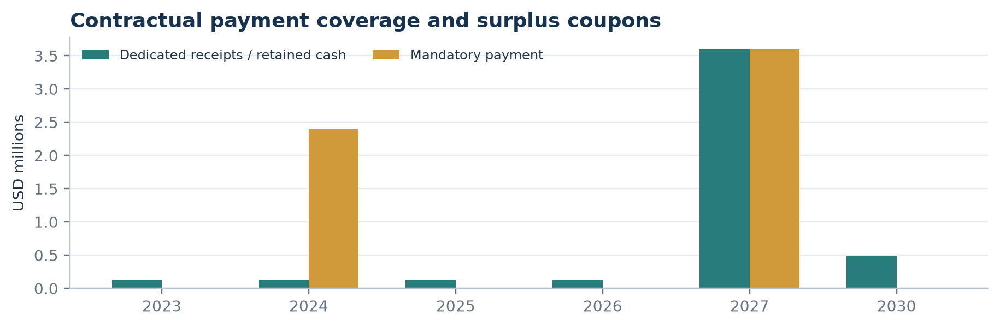
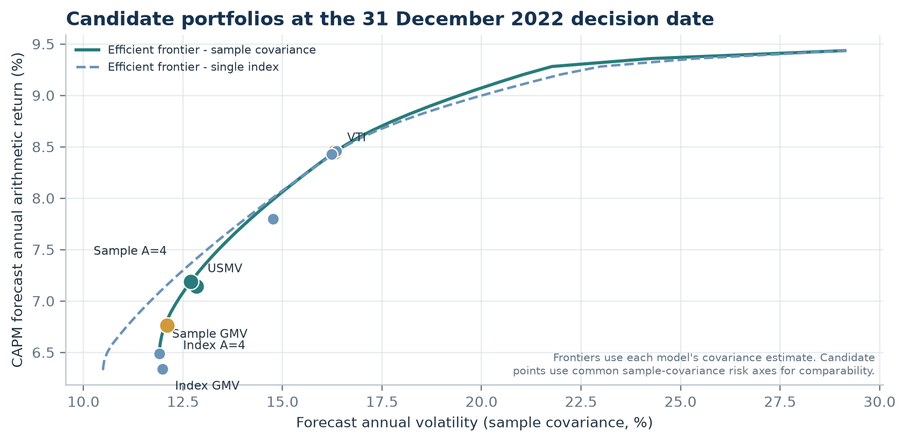
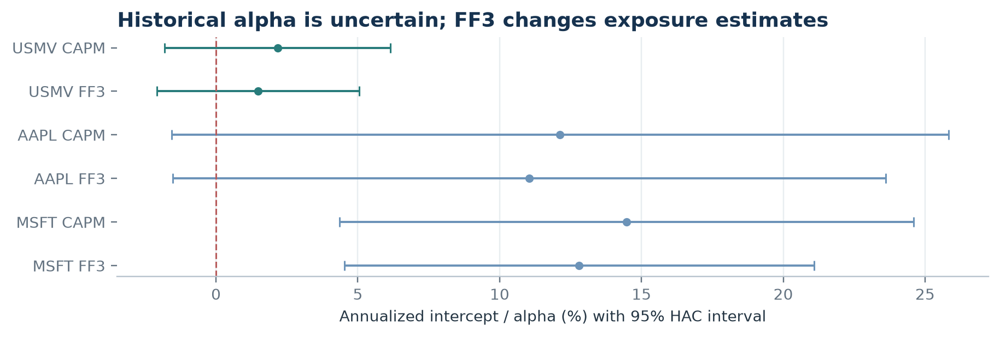
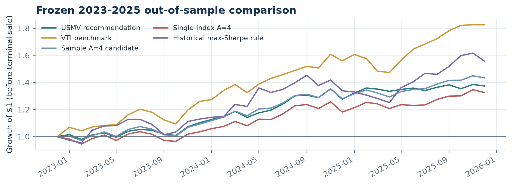
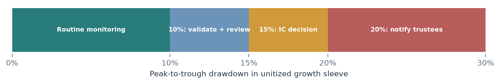

# Kappa Foundation investment policy

Committee memorandum | Original mandate | Decision date: 31 December 2022

## Page 1

# Kappa Foundation investment policy

Committee memorandum \| Original mandate \| Decision date: 31 December 2022 \| Prepared for the 29 October committee submission

### Recommendation

> Fund the two fixed education payments first with Beta and Delta bonds. Invest the remaining growth capital in USMV as the selected, simple long-only implementation; use VTI as the investable growth benchmark. The allocation seeks to protect obligations and preserve long-run purchasing power; it does not guarantee the 2030 goal or a maximum loss.

### Mandate and investment objective

Kappa begins with USD 12.0m, must pay USD 2.4m on 31 December 2024 and USD 3.6m on 31 December 2027, and aims to retain at least USD 8.0m of December-2022 purchasing power by 31 December 2030. The priority is to meet non-cancellable education commitments, then invest surplus capital for real growth within the fund's risk capacity. The fund will not raise risk solely to make a shortfall forecast look attainable.

### Working policy and assumptions

| Decision input | Base convention | Purpose / limit |

| --- | --- | --- |

| Goal inflation | CPI 2.5%; HEPI 3.0% separate stress | CPI defines the primary real-goal test; HEPI tests education-cost pressure. |

| Risk preference | A = 4; compare A = 1, 2, 6, 8 | Provisional utility preference, not inferred from the 15% trigger. |

| Forecast inputs | CAPM: RF 4.0%, market premium 4.5%, alpha 0 | Planning inputs as of the case date; FF3 explains returns, but factor premia are not forecast. |

| Estimation | 96 monthly observations, Jan 2015-Dec 2022; 60-month sensitivity | All portfolio weights are formed using information through 31 Dec 2022. |

| Implementation | Long-only; no borrowing, short sales or derivatives; no extra concentration caps | 10%/30% caps from an earlier draft were not approved and are excluded. |

| Costs | 5bp bonds; 10bp equity; 0% cash reinvestment | Planning friction; lower-fee schedule is reported as a sensitivity. |

Exhibit 1. Full USD 12m: Beta $2,214,672; Delta $3,429,809; growth sleeve $6,346,351; total assumed execution costs $9,169 ($2,822 bonds and $6,346 equities).

The 2.5% CPI planning rate is anchored approximately to the 30 December 2022 nominal Treasury-TIPS spread; it is not a forecast guarantee. HEPI is a separate 3.0% mission-cost stress and may not match Kappa's scholarship cost basket. The nominal 2030 goal is USD 9.747m under CPI and USD 10.134m under HEPI.

## Page 2

### 1 \| Fund contractual payments before taking growth risk

The payment portfolio is designed around cash due dates. Beta is a two-year zero-coupon bond. Delta's year-five principal plus final coupon equals the 2027 payment. The Delta coupons are retained as cash and earn 0% in the base case; no coupon is counted twice.

| Use | Face amount | Purchase cost | Due-date cash flow |

| --- | --- | --- | --- |

| Beta | $2,400,000 | $2,214,672 | $2,400,000 on 31 Dec 2024 |

| Delta | $3,478,261 | $3,429,809 | $3,600,000 on 31 Dec 2027 |

| Bond fees | - | $2,822 | 5bp assumed |

| Total dedicated bonds | $5,878,261 | $5,647,303 | Both fixed payments covered |

Exhibit 2. Delta's four coupons before maturity total USD 486,957. They remain separate cash; the 2024 payment is covered by the full USD 2.4m Beta face amount.

### Bond valuation and incomplete curve

| Bond | YTM | Mod. duration | Convexity | +100bp parallel | -100 to +100bp steepener |

| --- | --- | --- | --- | --- | --- |

| Beta | 4.10% | 1.921 | 5.537 | -1.98% | +1.44% |

| Delta | 3.81% | 4.499 | 25.402 | -4.56% | -0.48% |

| Epsilon | 3.90% | 6.659 | 54.785 | -6.66% | -5.79% |

Spot discount factors are observed or bootstrapped at years 1, 2, 3, 5 and 8. Log discount factors are interpolated linearly between knots; a separately calibrated linear-zero curve is the interpolation sensitivity. Both curves reproduce the five case quotes. The parallel test shifts every continuous spot rate by +100bp. The curve-shape test moves the one-year rate down 100bp and the eight-year rate up 100bp, linearly by maturity. Exact repricing from contractual cash flows is compared with duration-convexity estimates.

The +100bp parallel shock is a material late-2022 sensitivity; +200bp is also calculated as a severe stress. A forced early sale or a changed payment date would reintroduce market-price risk. Epsilon is not used to fund near-term liabilities in the base allocation because its longer duration creates interim loss exposure. Curve-shape risk is asymmetric: the steepener raises Beta's price slightly but lowers Delta and Epsilon prices.

Generated evidence: outputs/tables/bond_metrics.csv, bond_curve.csv, bond_stress.csv, ytm_duration_validation.csv and funding_cashflows.csv; calculation in analysis/bonds.py and analysis/supplement.py.

## Page 3

### 2 \| Growth allocation: a decision rule, then a portfolio

After bond costs and equity execution costs, the investable growth sleeve is USD 6,346,351 (52.9% of initial resources). Under the primary CPI assumption, the goal requires a 4.84% annual compound return from this sleeve for eight years, plus the retained USD 486,957 coupons. Under the HEPI stress, the growth hurdle rises to 5.37%. These are deterministic hurdles, not forecasts.

### Optimization objective

For the risk-bearing sleeve, compare U = E(Rp) - 0.5 x A x variance(Rp), with A=4 as the working preference and a sensitivity grid around it. This is a transparent risk-return comparison, not a complete model of a university foundation's liabilities. The bond sleeve separately addresses the fixed payment dates. Long-only weights sum to 100%; there are no unapproved single-name or ETF caps.

Expected return is CAPM: 4.0% prospective risk-free rate + estimated market beta x 4.5% market risk premium. Forecast alpha is zero. Risk is estimated twice: (i) sample covariance of the 96 monthly asset returns, annualized by multiplying covariance by 12, and (ii) a single-index covariance using market betas and idiosyncratic residual variances. The same ten candidates and CAPM means are used for both optimizations.

Exhibit 3. The A=4 portfolios were optimized under separate covariance models. All displayed points use the common sample covariance axes for direct comparison; single-index risk changes the optimization inputs, not the candidate list.

### Selected growth allocation \| USMV-only, the approved working policy

| Holding | Weight | USD allocation | Portfolio role |

| --- | --- | --- | --- |

| USMV | 100.00% | $6,346,351 | Diversified US minimum-volatility equity exposure |

| Total | 100.00% | $6,346,351 | Long-only; no borrowing or shorting |

The full-universe A=4 optimizer is a diagnostic, not the selected implementation. Its sample point estimates marginally dominate USMV, with slightly higher expected return and slightly lower volatility, but the certainty-equivalent gain is only about 0.12 percentage points. It adds six direct positions and materially model-sensitive weights. The committee therefore retains the previously selected one-fund policy as a governance choice, while recording the optimizer's result as adverse evidence that should be reconsidered if the weights prove robust.

## Page 4

### 3 \| Alternatives, covariance sensitivity and implementation

At A=4, expected returns are the same CAPM means in both covariance runs. The table shows volatility, Sharpe and certainty equivalent under sample covariance and single-index covariance, respectively. The sample optimizer's own utility is 3.96%; the single-index optimizer's own utility is 4.29%. Re-scoring the single-index portfolio with sample covariance gives 3.83%. Switching between the two optimized sets changes 18.3% of the sleeve one-way. Expected returns and covariances are uncertain, so the optimizer result is evidence for review rather than an automatic mandate change.

| Candidate | Model / rule | E(R) CAPM | Vol S/Idx (%) | SR S/Idx | CE S/Idx (%) | Weights |

| --- | --- | --- | --- | --- | --- | --- |

| Selected policy | USMV 100% | 7.14% | 12.84 / 12.86 | 0.24 / 0.24 | 3.84 / 3.84 | 100% USMV |

| Optimizer candidate | Sample max utility | 7.19% | 12.70 / 12.28 | 0.25 / 0.26 | 3.96 / 4.18 | USMV 46.2%; VTI 17.9%; 6 stocks |

| Model sensitivity | Single-index max utility | 6.76% | 12.11 / 11.11 | 0.23 / 0.25 | 3.83 / 4.29 | USMV 49.6%; VTI 8.3%; 4 stocks |

| Credible rejected alternative | 100% VTI | 8.45% | 16.31 / 16.34 | 0.27 / 0.27 | 3.13 / 3.11 | Broad US market only |

| Risk floor reference | Sample GMV | 6.49% | 11.91 / 10.71 | 0.21 / 0.23 | 3.65 / 4.20 | USMV 39.5%; PG 24.2%; JNJ 16.0% |

| Simple benchmark mix | 50/50 ETF mix | 7.79% | 14.24 / 14.22 | 0.27 / 0.27 | 3.74 / 3.75 | Two ETFs only |

| Historical rule | Historical max Sharpe | 7.16% | 14.93 / 14.93 | 0.21 / 0.21 | 2.71 / 2.70 | Largest positions NEE 41.3%; MSFT 33.2% |

Columns show annual CAPM forecast return, then sample / single-index volatility (%), Sharpe and A=4 certainty equivalent (%). Both risk models use the same forecast mean vector. The Eta row reports CAPM scores for the historical-Sharpe weights; the weights were formed from 2015-2022 historical average returns relative to French RF. Its 20.38% training CAGR is an in-sample outcome, not a forecast.

The sample optimizer allocates USMV 46.18%, VTI 17.89%, PG 11.62%, JNJ 7.46%, NEE 7.45%, JPM 3.52%, XOM 2.96% and MSFT 2.92%; AAPL and CAT receive zero. The single-index result holds USMV 49.63%, PG 15.79%, JNJ 15.08%, NEE 10.51%, VTI 8.35% and MSFT 0.64%; the remaining names receive zero. The 60-month sensitivity changes sample A=4 weights by 34.8% one-way, a warning that the optimizer is sensitive to its estimation window.

VTI is the credible rejected alternative: it offers the higher forecast return and is investable as a simple broad-market fund, but its A=4 certainty equivalent is lower because its modeled variance is higher. The 50/50 ETF mix and GMV portfolio remain useful reference points, not additional recommendations.

### Why the covariance estimate matters

The sample model estimates all pairwise relationships directly. The single-index model assumes common co-movement is mostly explained by the market and treats residual covariance as zero. The different weights and 18.3% model-switch turnover are material enough to monitor, but they do not outweigh the policy preference for a simple defensive implementation. No extra stock/ETF caps were imposed; long-only, fully invested weights are the assignment constraints.

Implementation: rebalance only after an authorized annual review or a documented drift/funding event. The original decision is frozen at 31 December 2022; use the same weights for the 2023-2025 evaluation. No extra caps, turnover bands or automatic sales are assumed unless separately approved.

Generated evidence: outputs/decision_review_20261021/growth_candidate_comparison.csv and growth_candidate_weights.csv; original candidate universe and source returns are retained under data/raw and outputs/tables.

## Page 5

### 4 \| Market and factor evidence: exposure is not alpha

The selected growth sleeve is 100% USMV, so its USMV regressions below are also the growth-portfolio regressions. CAPM gives a market-only account; FF3 adds size (SMB) and value (HML) exposures. AAPL and MSFT are two selected candidate securities reviewed alongside the ETF, not direct holdings in the chosen allocation. All models use 96 monthly excess returns ending in December 2022 and three-lag HAC standard errors.

Exhibit 4. Alpha estimates with 95% HAC confidence intervals. AAPL and MSFT intervals are wide; a positive point estimate is not proof of persistent skill.

| Security / model | Market beta | SMB beta | HML beta | Annual alpha (95% interval) | Alpha p |

| --- | --- | --- | --- | --- | --- |

| USMV CAPM | 0.70 | - | - | 2.17% (-1.81, 6.15) | 0.285 |

| USMV FF3 | 0.74 | -0.30 | -0.05 | 1.49% (-2.09, 5.06) | 0.415 |

| AAPL CAPM | 1.21 | - | - | 12.13% (-1.57, 25.84) | 0.083 |

| AAPL FF3 | 1.27 | -0.29 | -0.54 | 11.04% (-1.53, 23.62) | 0.085 |

| MSFT CAPM | 0.96 | - | - | 14.47% (4.36, 24.59) | 0.005 |

| MSFT FF3 | 1.06 | -0.62 | -0.36 | 12.81% (4.54, 21.08) | 0.002 |

For USMV, FF3 raises R-squared from 0.805 to 0.848 and identifies negative SMB exposure; its alpha remains statistically indistinguishable from zero. For AAPL and MSFT, FF3 adds negative SMB and HML loadings. MSFT's positive in-sample alpha is statistically significant under both fitted models, but it was selected after screening a small survivor universe and can reflect omitted exposures, model selection or chance. Forecast alpha remains zero rather than extrapolating any of these intercepts.

The model therefore uses CAPM betas for expected-return inputs and FF3 for explanation and challenge. SMB/HML premia are not inserted into the forecast because the policy has not fixed defensible prospective factor premia. Factor regressions do not establish that a security will earn abnormal returns in the next period; they describe covariance with historical factor portfolios.

Universe limitation: eight US stocks and VTI/USMV were selected for data continuity and mandate coverage. They are not a point-in-time investable universe; later-known survivors can bias historical comparison. No 2023-2025 performance was used to select the 2022 weights. Factor data are the saved Kenneth French vintage, scaled from percent to decimal; Yahoo adjusted close is used once for total-return construction, with no second dividend addition.

Generated evidence: outputs/tables/factor_regressions.csv, alpha_stability.csv, expected_return_inputs.csv and train_data_quality.csv; analysis/analyze.py and analysis/verify_factor_portfolio.py.

## Page 6

### 5 \| Frozen out-of-sample evidence, 2023-2025

The original allocation was fixed using data through 2022. This section tests those frozen weights using 36 monthly observations from January 2023 through December 2025. The portfolio starts with a 10bp entry-cost assumption; VTI is charged the same assumed entry friction. No 2023-2025 information feeds back into the original selection.

Exhibit 5. Wealth paths start at USD 0.999 after the assumed 10bp entry cost; annual rebalance friction is included. Adjusted prices include distributions. The figure is retrospective, not evidence available at the decision date.

| Frozen strategy | Cumulative return | CAGR | Annual vol. | Sharpe | Month-end max DD |

| --- | --- | --- | --- | --- | --- |

| Recommended USMV | 37.33% | 11.15% | 9.64% | 0.66 | -5.66% |

| VTI benchmark | 82.56% | 22.22% | 12.54% | 1.30 | -9.11% |

| Sample A=4 optimizer | 43.37% | 12.76% | 9.94% | 0.79 | -6.53% |

| Single-index A=4 | 32.47% | 9.83% | 10.59% | 0.50 | -6.89% |

| Eta historical Sharpe | 55.59% | 15.88% | 15.15% | 0.74 | -13.90% |

The convenient result is that USMV had a smaller month-end drawdown and lower volatility than VTI. The inconvenient result is that it lagged VTI's cumulative return by 45.23 percentage points and its Sharpe ratio by 0.64. The sample A=4 optimizer and Eta also beat USMV over this particular window, while the single-index optimizer lagged it. None of these results proves that a rule will persist or justifies choosing it with hindsight.

Decision implication: the evaluation supports the risk trade-off but rejects any claim of benchmark outperformance. It is too short to establish a full market-cycle result; month-end data miss intramonth losses; the present-day survivor universe and revised vendor histories remain limitations. Continue the selected policy only while the liability funding, risk preference and mandate remain valid. Underperformance triggers diagnosis and review, not automatic risk-taking to catch up.

Generated evidence: outputs/decision_review_20261021/growth_candidate_comparison.csv, growth_candidate_weights.csv and growth_candidate_evaluation_wealth.csv; analysis/compare_growth_options_20261021.py. The separate original evaluation tables remain available for audit, but this comparison uses one common no-cap universe, rebalance rule and entry-cost convention.

## Page 7

### 6 \| Risk limits, stress and governance

The 15% concern applies primarily to the growth sleeve's cash-flow-adjusted, unitized total-return drawdown from its prior high-water mark. A drawdown trigger starts a review; it is not a promise that losses stop at that number. Because equity prices can gap, a stop order cannot guarantee a 15% economic-loss floor.

| Signal | Required response | Trading rule |

| --- | --- | --- |

| 10% growth-sleeve drawdown | Within 2 business days, validate prices, distributions, unitization, cash flows, payment coverage, stress and goal funding; report to IC. | No automatic trade. |

| 15% drawdown | IC meets within 5 business days; records hold, a separately pre-authorized rebalance, or a prospective policy change for trustees. | No automatic full sale. |

| 20% drawdown | Notify trustees same or next business day; pause discretionary risk increases pending review; record funding, owner and next review. | No automatic liquidation. |

| Payment shortfall risk | Escalate immediately, regardless of drawdown; prepare a dated funding plan and restore due-date coverage through authorized action. | Do not wait for 10/15/20%. |

Use month-end unit values for academic replication; operational monitoring may be weekly if reliable prices and cash-flow records are available. External contributions and withdrawals are unitized so payments do not masquerade as investment losses. Whole-fund stress and liability coverage are reported separately.

### Upside rule

At each annual review, first reconfirm payment coverage and the CPI-based 2030 goal. Apply a -30% shock to the remaining growth sleeve using current executable prices and permitted assets. If the goal remains funded after that shock, transfer only the minimum amount required into an eligible asset matched to the goal date; keep surplus under the growth policy. If the test fails, disclose the dollar gap and required return; do not raise risk solely to catch up. No fixed gain triggers a sale.

Any crisis deferral of discretionary action requires written approval from the authorized body, a reason, an expiry date and review schedule. It cannot reduce coverage for a payment already due. Instrument eligibility and valuation convention for goal protection require formal approval before implementation.

Source: user-selected working IPS rules recorded in policy/IPS_addendum_selected_drawdown_rules_2026-10-21.json; these are proposed group policy, not trustee authorization.

## Page 8

### 7 \| Sensitivity, reversal point and committee monitoring

A decision should change when a key input changes enough to alter the trade-off, not when a noisy monthly return changes sign. One transparent reversal threshold comes from the two ETF utility comparison. Under the saved CAPM means and sample covariance, USMV has higher A=4 certainty equivalent than VTI. The ranking reverses at A approximately 2.58: below that preference parameter, VTI's higher return outweighs its higher variance. At A=4, raising the assumed market risk premium above approximately 6.98% also reverses the two-ETF ranking. These thresholds are model-specific and are not policy commands.

| Sensitivity | Base | Stress / threshold | Implication |

| --- | --- | --- | --- |

| Inflation / goal | CPI 2.5%; nominal goal $9.747m | HEPI 3.0%; goal $10.134m; hurdle 5.37% | Recalculate real-goal funding; do not blend indices. |

| Risk preference | A=4 | A<2.58 favors VTI over USMV | Trustees must define risk preference; drawdown triggers do not estimate A. |

| Market risk premium | 4.5% | Above 6.98% reverses USMV/VTI at A=4 | Revisit expected returns only with an evidence-based premium. |

| Training window | 96 months | 60-month A=4 weight turnover 34.8% one-way | Optimizer weights are sensitive; preserve simple benchmark and governance. |

| Costs | 5bp bonds / 10bp equity | 0bp bonds / 5bp ETF / 10bp direct equity | Lower fee schedule raises growth capital by about $5,992; ranking unchanged. |

| Stress path | Base goal path | Immediate -30% growth shock raises remaining CAGR hurdle to about 9.6% | Protect obligations first; diagnose market-wide shock vs portfolio underperformance. |

### Committee monitoring after implementation

Each quarter, report dated payment coverage, cash and coupon reconciliation, growth-sleeve drawdown, current weights, benchmark-relative return, costs, mandate changes and the CPI goal funding ratio. At the annual review, refresh expected returns only from approved inputs, compare sample and single-index risk, test current liabilities and run the -30% goal-protection test. For underperformance, separate broad-market conditions, strategy/benchmark mismatch, asset-specific evidence, data errors and implementation costs before changing the portfolio.

Evidence against the recommendation must remain visible: the sample optimizer marginally dominates USMV on point estimates, VTI outperformed over 2023-2025, Eta's historical-Sharpe strategy also had a stronger period return, and the 60-month sensitivity changes optimized weights substantially. The favorable evidence is the lower estimated volatility and better A=4 utility than a VTI-only allocation, plus the payment bonds' contractual cash-flow coverage. The choice is therefore a reviewable governance judgment, not the model's numerical maximum and not a claim that future returns are known.

### Data and record status

The assignment is retrospective, not a live investment experiment. Yahoo Finance and Kenneth French files were downloaded after the case date, with raw bytes, retrieval settings, versions and hashes retained. Historical data vintages may have been revised. The original candidate universe is selected with hindsight risk. The actual 23 October revised mandate is not yet available as of this memo's preparation; apply it in a separate version while preserving the 2022 decision and the frozen 2023-2025 evaluation. AI-assisted analysis requires student source checks, genuine contribution statements and compliance with course AI rules before submission.

This memorandum is an academic case analysis; it is not an investment offer or a guarantee of returns, goal achievement or a loss ceiling.

## Page 9

### References and audit trail

### Assignment and case data

[1] BFIN-WS2026 Group Assignment, supplied course document. Contractual payment dates and amounts, bond quotes, initial resources, candidate-selection and analysis requirements, 2022 decision cutoff, and 2023-2025 evaluation period.

### Data sources and construction

[2] Yahoo Finance price and corporate-action history accessed through yfinance. Retrieval settings and raw file hashes are in data/raw/retrieval_manifest.jsonl. Monthly returns use last-trading-day adjusted closes; dividends are not added again. [3] yfinance download API documentation: https://ranaroussi.github.io/yfinance/reference/api/yfinance.download.html.

[4] Kenneth R. French Data Library, Fama/French monthly factors and U.S. research returns: https://mba.tuck.dartmouth.edu/pages/faculty/ken.french/data_library.html. Original saved ZIP bytes are in data/raw/factors/. Percent units are converted to decimals before regression.

[5] Federal Reserve, Summary of Economic Projections, 14 December 2022: https://www.federalreserve.gov/monetarypolicy/fomcprojtabl20221214.htm. [6] Federal Reserve Bank of St. Louis FRED, 10-year Treasury inflation-indexed security and nominal constant-maturity series; the 30 December 2022 spread is an approximate market-implied CPI planning anchor, not an unbiased forecast. https://fred.stlouisfed.org/series/T10YIE.

[7] Commonfund Institute, Higher Education Price Index (HEPI), annual historical series: https://www.commonfund.org/hepi. HEPI is used as a separate mission-cost stress; the 3.0% planning value is an assumption.

### Instrument and eligibility references

[8] Vanguard Total Stock Market ETF (VTI), summary prospectus filed with the SEC before the decision date: https://www.sec.gov/Archives/edgar/data/36405/000168386320005993/f4654d1.htm. [9] iShares MSCI USA Min Vol Factor ETF (USMV), contemporaneous SEC-filed description: https://www.sec.gov/Archives/edgar/data/886982/000156459022026948/gs-424b2.htm. Direct Python SEC requests returned HTTP 403; the links and concise eligibility notes are retained in data/raw/supporting/source_register.json. Full SEC documents were not saved locally.

[10] SISF Global Multi-Asset Income Fund A Acc, factsheet dated 21 September 2026, provided by the user. Used only as a visual-reference example for information hierarchy and chart/table clarity; no SISF performance, allocation or product facts are used as Kappa evidence.

### Calculation trail

Bond valuation and cash-flow schedules: analysis/bonds.py and analysis/supplement.py. Return and factor analysis: analysis/analyze.py. Source-byte and equation checks: analysis/verify_source_chain.py and analysis/verify_core_equations.py. Candidate portfolio comparisons: analysis/compare_growth_options_20261021.py and outputs/decision_review_20261021/. The report's tables cite named CSV/JSON files at the end of each relevant page. Run analysis/rebuild.py offline to regenerate canonical figures and checks; run analysis/build_committee_memo_20261021.py to rebuild this memo from saved tables.

### Disclosure

AI tools assisted with source discovery, scripting, calculations and drafting. Automated checks establish repeatability and arithmetic consistency, not investment judgment, data completeness, course-policy compliance or students' individual contributions. The group must review source records and record actual work and independent checks before submission.
